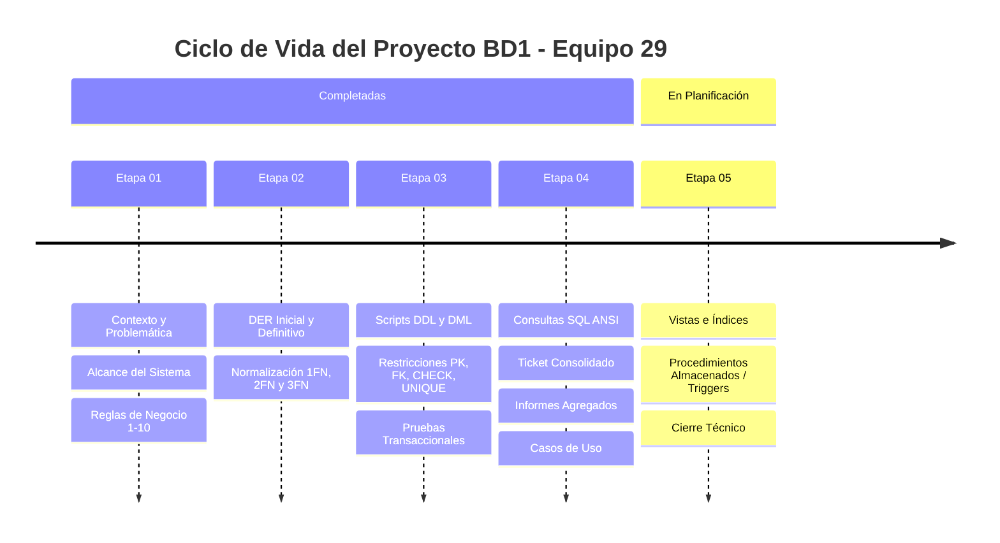
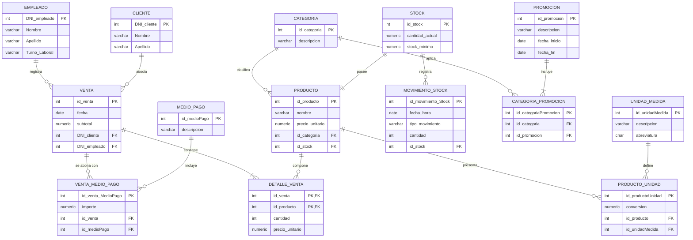
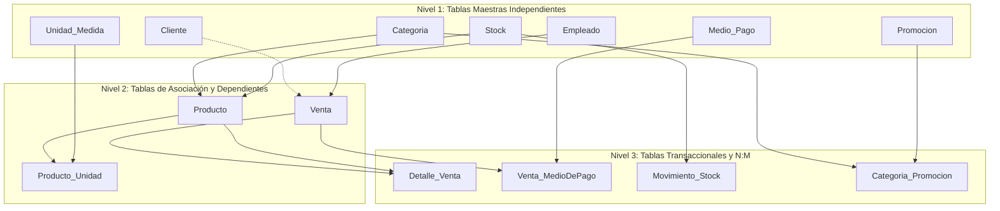

# <div align="center">🥖 Sistema de Gestión de Ventas — Panadería Tortuga</div>

<div align="center">

**Bases de Datos I** | **Facultad / Cátedra de Bases de Datos**  
**Equipo N° 29** • Ciclo Lectivo 2026

[](https://github.com/sofinazaret6-gif/proyecto-bd1-equipo-29)
[](https://github.com/sofinazaret6-gif/proyecto-bd1-equipo-29)
[-CC292B?style=for-the-badge&logo=microsoftsqlserver&logoColor=white)](sql/)
[](docs/etapa-02/normalizacion.md)
[](docs/etapa-01/)
[](docs/etapa-02/)
[](docs/etapa-03/)
[](docs/etapa-04/)

*Un sistema de base de datos relacional robusto y normalizado en 3FN, implementado en Microsoft SQL Server con scripts DDL, dataset DML de prueba, validaciones transaccionales y consultas analíticas avanzadas de negocio.*

---

[📋 Guía Rápida Docente](#-guía-rápida-de-evaluación-para-docentes) •
[👥 Integrantes](#-integrantes-del-equipo-29) •
[🎯 Propuesta](#-sobre-el-proyecto) •
[📊 Modelo y 3FN](#-modelo-de-datos-y-normalización) •
[🛠️ Implementación DDL/DML](#-etapa-03-implementación-física-ddl-dml-y-validaciones) •
[📈 Consultas y Casos de Uso](#-etapa-04-consultas-sql-y-casos-de-uso-de-negocio) •
[📂 Archivos](#-estructura-del-repositorio)

---
</div>

## 📌 Tabla de Contenidos

1. [👩‍🏫 Guía Rápida de Evaluación para Docentes](#-guía-rápida-de-evaluación-para-docentes)
2. [👥 Integrantes del Equipo 29](#-integrantes-del-equipo-29)
3. [🎯 Sobre el Proyecto](#-sobre-el-proyecto)
   - [Contexto y Problemática](#contexto-y-problemática)
   - [Objetivos Principales](#objetivos-principales)
   - [Alcance del Sistema y Exclusiones](#alcance-del-sistema-y-exclusiones)
4. [📜 Reglas de Negocio del Dominio (RN.01 a RN.10)](#-reglas-de-negocio-del-dominio)
5. [🗺️ Hoja de Ruta de Entregas (Etapas 01 a 05)](#-hoja-de-ruta-de-entregas-etapas)
6. [📊 Modelo de Datos y Normalización (Etapa 02)](#-modelo-de-datos-y-normalización)
   - [Diagramas Entidad-Relación (DER)](#diagramas-entidad-relación-der)
   - [Evolución de Normalización (1FN ➔ 2FN ➔ 3FN)](#evolución-de-normalización-1fn--2fn--3fn)
   - [Diagrama Relacional Definitivo (3FN Interactivo)](#diagrama-relacional-definitivo-3fn-interactivo)
   - [Diccionario del Esquema Relacional](#diccionario-del-esquema-relacional)
7. [🛠️ Etapa 03: Implementación Física (DDL), DML y Validaciones](#-etapa-03-implementación-física-ddl-dml-y-validaciones)
   - [Jerarquía de Tablas Físicas](#jerarquía-de-tablas-físicas)
   - [Restricciones de Integridad y Reglas CHECK](#restricciones-de-integridad-y-reglas-check)
   - [Pruebas Transaccionales y Verificación de Consistencia](#pruebas-transaccionales-y-verificación-de-consistencia)
8. [📈 Etapa 04: Consultas SQL y Casos de Uso de Negocio](#-etapa-04-consultas-sql-y-casos-de-uso-de-negocio)
   - [Matriz de Consultas SQL Implementadas](#matriz-de-consultas-sql-implementadas)
   - [Mapeo de Casos de Uso (CU-01 a CU-06)](#mapeo-de-casos-de-uso-del-sistema-comercial)
9. [📂 Estructura del Repositorio](#-estructura-del-repositorio)
10. [💻 Instrucciones de Instalación y Ejecución](#-instrucciones-de-instalación-y-ejecución)

---

## 👩‍🏫 Guía Rápida de Evaluación para Docentes

Esta tabla reúne los accesos directos a todos los entregables requeridos a lo largo de las etapas del proyecto para facilitar la corrección y verificación:

| Etapa | Requisito / Entregable | Ubicación en el Repositorio | Descripción Técnica |
| :---: | :--- | :--- | :--- |
| **01** | **Introducción y Contexto** | [`docs/etapa-01/Introduccion...md`](docs/etapa-01/Introduccion%20Gestion%20de%20Ventas%20de%20Panaderia.md) | Problemática de panadería de barrio, dinámica de mostrador y objetivos. |
| **01** | **Justificación del Proyecto** | [`docs/etapa-01/justificacion_Proyecto.md`](docs/etapa-01/justificacion_Proyecto.md) | Análisis de dominio, viabilidad económica y arquitectura relacional. |
| **01** | **Alcance del Sistema** | [`docs/etapa-01/alcance_del_sistema.md`](docs/etapa-01/alcance_del_sistema.md) | Módulos POS, stock, compras, catálogo y delimitaciones deliberadas. |
| **01** | **Reglas de Negocio (1 al 5)** | [`docs/etapa-01/Reglas de Negocio 1-5.md`](docs/etapa-01/Reglas%20de%20Negocio%201-5.md) | Catálogo, stock por movimientos, cliente opcional, precios históricos y pagos mixtos. |
| **01** | **Reglas de Negocio (6 al 10)**| [`docs/etapa-01/Reglas de Negocio 6-10.md`](docs/etapa-01/Reglas%20de%20Negocio%206-10.md) | Tickets, auditoría de personal, compras, validación de stock y promociones temporales. |
| **02** | **DER Borrador Inicial** | [`docs/etapa-02/Der/derInicial.png.png`](docs/etapa-02/Der/derInicial.png.png) | Diagrama conceptual preliminar en notación Peter Chen (ERDPlus). |
| **02** | **DER Definitivo** | [`docs/etapa-02/Der/DerDefinitivo.jpeg`](docs/etapa-02/Der/DerDefinitivo.jpeg) | Modelo conceptual final con stock, unidades fraccionables y promociones. |
| **02** | **Memoria de Normalización** | [`docs/etapa-02/normalizacion.md`](docs/etapa-02/normalizacion.md) | Justificación paso a paso del pasaje a 1FN, 2FN y 3FN sin pérdida. |
| **02** | **Galería de Modelos Lógicos** | [`imagenes/`](imagenes/) | Esquemas relacionales en PNG y definiciones Mermaid interactivas (0FN a 3FN). |
| **03** | **Script DDL de Base de Datos** | [`sql/ddl/crear_bd.sql`](sql/ddl/crear_bd.sql) | Script T-SQL idempotente con creación de BD, tablas, PKs, FKs, CHECKs y UNIQUEs. |
| **03** | **Script DML de Poblado** | [`sql/dml/datos_prueba.sql`](sql/dml/datos_prueba.sql) | Dataset ampliado y consistente de prueba para tablas maestras y transaccionales. |
| **03** | **Documentación DDL / DML** | [`docs/etapa-03/implementacion.md`](docs/etapa-03/implementacion.md) | Detalle de construcción por niveles, tipos de datos y consistencia histórica. |
| **03** | **Restricciones de Integridad** | [`docs/etapa-03/restricciones-integridad.md`](docs/etapa-03/restricciones-integridad.md) | Catálogo de reglas `CHECK`, `UNIQUE`, `FOREIGN KEY` y dominios numéricos. |
| **03** | **Pruebas y Validaciones** | [`docs/etapa-03/pruebas-validaciones.md`](docs/etapa-03/pruebas-validaciones.md) | Pruebas de inserción negativa, violaciones de clave y consistencia de cobros mixtos. |
| **04** | **Comprobante de Venta (Ticket)** | [`sql/consultas/comprobante_venta.sql`](sql/consultas/comprobante_venta.sql) | Emisión de ticket fiscal consolidado con `COALESCE`, subtotales y subconsulta ANSI. |
| **04** | **Doc. Comprobante de Venta** | [`docs/etapa-04/comprobante-venta.md`](docs/etapa-04/comprobante-venta.md) | Documentación técnica del comprobante consolidado (CU-01). |
| **04** | **Informes de Ventas Agregados** | [`sql/consultas/informe_ventas.sql`](sql/consultas/informe_ventas.sql) | Reportes analíticos de ventas agrupadas por Vendedor y por Categoría. |
| **04** | **Doc. Informes de Ventas** | [`docs/etapa-04/informe-ventas.md`](docs/etapa-04/informe-ventas.md) | Justificación técnica y métricas agregadas por vendedor y categoría (CU-03 / CU-04). |
| **04** | **Consulta Avanzada (Clientes VIP)**| [`sql/consultas/consulta_avanzada.sql`](sql/consultas/consulta_avanzada.sql) | Consulta analítica con 3 tablas, agregaciones y filtro restrictivo `HAVING`. |
| **04** | **Doc. Consulta Avanzada** | [`docs/etapa-04/consulta-avanzada.md`](docs/etapa-04/consulta-avanzada.md) | Análisis de facturación acumulada y segmentación de clientes frecuentes (CU-05). |
| **04** | **Casos de Uso y Validación Cruzada** | [`docs/etapa-04/casos-uso.md`](docs/etapa-04/casos-uso.md) | Mapeo integral de requerimientos funcionales, CU-01 a CU-06 y verificación cruzada. |

---

## 👥 Integrantes del Equipo 29

| Integrante | DNI |
| :--- | :---: |
| **Kiara Itatí Zacarías** | `46.717.369` |
| **Sofía Ferretti** | `46.718.162` |
| **Nicolás Pini** | `46.844.274` |
| **Lucas Martín Zárate** | `34.936.602` |
| **Octavio Dorrego** | `46.843.173` |

---

## 🎯 Sobre el Proyecto

### Contexto y Problemática
Las panaderías de barrio operan bajo un modelo comercial caracterizado por **alta rotación, velocidad de despacho y venta combinada** (artículos por peso fraccionado, por docena o por unidad individual). Históricamente, estos comercios dependen de anotaciones en papel, tickets manuales o calculadoras, lo que ocasiona:
- Falta de concordancia entre el inventario físico en obrador/mostrador y las ventas registradas.
- Dificultad para registrar **cobros combinados o mixtos** (por ejemplo, parte en efectivo y el saldo por transferencia/QR o tarjeta).
- Desajustes financieros ante aumentos en el catálogo al no congelar los precios unitarios al instante exacto de la transacción.

### Objetivos Principales
1. **Agilidad en el mostrador:** Un esquema de datos ágil y sin fricción para registrar ventas rápidamente.
2. **Control de inventario:** Ficha única de stock por producto con historial auditable de movimientos atómicos (ingresos, compras, mermas, ventas).
3. **Flexibilidad comercial:** Soporte para promociones temporales por categoría y múltiples medios de pago por comprobante.
4. **Integridad de datos:** Un diseño relacional formalmente normalizado en **Tercera Forma Normal (3FN)** sin redundancias ni anomalías de actualización.

### Alcance del Sistema y Exclusiones
- **Incluido en el alcance:** Módulo de Punto de Venta (POS) multi-ítem, catálogo con unidades fraccionables y fijas (kg, unidad, docena), control de existencias en tiempo real con alertas de stock mínimo, trazabilidad de compras a proveedores, registro de clientes (opcional para cuentas corrientes y fidelización) y promociones temporales vigentes.
- **Fuera de alcance deliberado:** No se incorporan módulos complejos de apertura y cierre de caja por turnos, ya que en comercios familiares la sesión operativa coincide con la jornada comercial diaria.

---

## 📜 Reglas de Negocio del Dominio

Las reglas de negocio que rigen la lógica de la base de datos se encuentran desglosadas en los documentos formales de la Etapa 01:

<details open>
<summary><b>📋 Resumen de Reglas de Negocio (RN.01 a RN.10)</b></summary>
<br>

| Regla | Título | Descripción Sintética | Documento Fuente |
| :---: | :--- | :--- | :---: |
| **RN.01** | **Productos y Unidades** | Cada producto pertenece a una única categoría y cuenta con unidades de medida definidas (kg, docena, unidad). | [`Reglas de Negocio 1-5.md`](docs/etapa-01/Reglas%20de%20Negocio%201-5.md) |
| **RN.02** | **Control de Stock** | Un producto posee una única ficha de stock con múltiples movimientos asociados (ingresos/egresos) y alerta de stock mínimo. | [`Reglas de Negocio 1-5.md`](docs/etapa-01/Reglas%20de%20Negocio%201-5.md) |
| **RN.03** | **Registro de Clientes** | Las ventas de mostrador pueden ser anónimas (`NULL`) o vincularse a un cliente único para cuenta corriente o fidelización. | [`Reglas de Negocio 1-5.md`](docs/etapa-01/Reglas%20de%20Negocio%201-5.md) |
| **RN.04** | **Historial de Precios** | Cada ítem de venta almacena la cantidad y el precio unitario pactado al instante de la venta, garantizando inmutabilidad histórica. | [`Reglas de Negocio 1-5.md`](docs/etapa-01/Reglas%20de%20Negocio%201-5.md) |
| **RN.05** | **Pagos Combinados** | Una venta puede cancelarse con uno o más medios de pago, desglosando el importe abonado con cada uno. | [`Reglas de Negocio 1-5.md`](docs/etapa-01/Reglas%20de%20Negocio%201-5.md) |
| **RN.06** | **Comprobantes y Empleados**| Cada venta genera un comprobante con fecha, hora y el empleado responsable de la atención en el mostrador. | [`Reglas de Negocio 6-10.md`](docs/etapa-01/Reglas%20de%20Negocio%206-10.md) |
| **RN.07** | **Compras a Proveedores** | Las compras se asocian a un proveedor, registrando costo unitario de adquisición y alimentando el inventario. | [`Reglas de Negocio 6-10.md`](docs/etapa-01/Reglas%20de%20Negocio%206-10.md) |
| **RN.08** | **Validación de Stock** | No es posible confirmar una venta si la cantidad solicitada supera el stock físico disponible en el inventario. | [`Reglas de Negocio 6-10.md`](docs/etapa-01/Reglas%20de%20Negocio%206-10.md) |
| **RN.09** | **Promociones Temporales** | Las promociones (descuentos, 2x1) aplican a categorías de productos y están sujetas a un período de vigencia (fecha inicio/fin). | [`Reglas de Negocio 6-10.md`](docs/etapa-01/Reglas%20de%20Negocio%206-10.md) |
| **RN.10** | **Estandarización de Calidad**| Solo los productos que cumplan los estándares de maduración y control de calidad quedan habilitados para su comercialización. | [`Reglas de Negocio 6-10.md`](docs/etapa-01/Reglas%20de%20Negocio%206-10.md) |

</details>

---

## 🗺️ Hoja de Ruta de Entregas (Etapas)



<details open>
<summary><b>🔎 Ver detalle del estado de cada etapa</b></summary>
<br>

| Etapa | Nombre | Estado | Entregables Principales |
| :---: | :--- | :---: | :--- |
| **01** | **Relevamiento del Negocio** | <kbd>✔ Completada</kbd> | Introducción, justificación, alcance del sistema y 10 reglas de negocio formales. |
| **02** | **Modelado Conceptual y Lógico** | <kbd>✔ Completada</kbd> | DER Peter Chen, conversión relacional, normalización formal hasta 3FN y diagramas Mermaid. |
| **03** | **Implementación Física (DDL y DML)**| <kbd>✔ Completada</kbd> | Scripts `crear_bd.sql`, `datos_prueba.sql`, restricciones de integridad y pruebas de consistencia. |
| **04** | **Consultas SQL y Casos de Uso** | <kbd>✔ Completada</kbd> | Consultas ANSI SQL (comprobante de venta, reportes agregados, consulta avanzada) y mapeo de casos de uso CU-01 a CU-06. |
| **05** | **Optimización y Cierre Técnico** | <kbd>⏳ Próximamente</kbd> | Vistas de resumen, índices de rendimiento, procedimientos almacenados y conclusiones técnicas del proyecto. |

</details>

---

## 📊 Modelo de Datos y Normalización

### Diagramas Entidad-Relación (DER)
El modelado conceptual partió de los requerimientos y evolucionó hacia un diagrama consolidado:

- 🖼️ **Borrador Conceptual Inicial:** [Ver imagen `derInicial.png.png`](docs/etapa-02/Der/derInicial.png.png)
- 🖼️ **DER Definitivo (Peter Chen):** [Ver imagen `DerDefinitivo.jpeg`](docs/etapa-02/Der/DerDefinitivo.jpeg)

---

### Evolución de Normalización (1FN ➔ 2FN ➔ 3FN)

El proceso de refinamiento lógico se encuentra documentado en detalle en [`docs/etapa-02/normalizacion.md`](docs/etapa-02/normalizacion.md):

| Fase | Diagnóstico / Anomalía Resuelta | Solución Aplicada | Esquema Gráfico | Diagrama Mermaid |
| :---: | :--- | :--- | :---: | :---: |
| **Estado Inicial** | Relaciones directas del DER presentaban grupos repetitivos en stock y pagos únicos rígidos. | Mapeo inicial de tablas y detección formal de anomalías de 1FN. | [🖼️ Ver 0FN](imagenes/erdplus%20imagen%200.png) | [📄 Ver 0FN .md](imagenes/erdplus%20imagen%200.md) |
| **1FN** | Violación de atomicidad en `STOCK` (`fk_MOVIMIENTO_STOCK`) y en `VENTA` (`fk_MEDIO_DE_PAGO`). | Se traslada la FK a `MOVIMIENTO_STOCK` y se crea la tabla intermedia `VENTA_MEDIO_DE_PAGO` con atributo `importe`. | [🖼️ Ver 1FN](imagenes/erdplus%20imagen%201.png) | [📄 Ver 1FN .md](imagenes/erdplus%20imagen%201.md) |
| **2FN** | Dependencia funcional parcial en tabla intermedia `ASOCIA (fk_CLIENTE, fk_VENTA)` ($id\_venta \rightarrow dni\_Cliente$). | Se elimina la tabla intermedia y se incluye `fk_CLIENTE` directamente como clave foránea en `VENTA` ($1:N$). | [🖼️ Ver 2FN](imagenes/erdplus%20imagen%202.png) | [📄 Ver 2FN .md](imagenes/erdplus%20imagen%202.md) |
| **3FN** | Dependencia transitiva en `PROMOCION` (`tipoPromocion` $\rightarrow$ `Valor`) y falta de factor de conversión en unidades. | Se depura `PROMOCION`, se formaliza `PRODUCTO_UNIDAD` con `conversion` y se estandariza la nomenclatura. | [🖼️ Ver 3FN](imagenes/erdplus%20imagen%203.png) | [📄 Ver 3FN .md](imagenes/erdplus%20imagen%203.md) |

---

### Diagrama Relacional Definitivo (3FN Interactivo)

El siguiente diagrama ilustra la arquitectura de datos final en **Tercera Forma Normal (3FN)**, renderizado de forma nativa e interactiva:



---

### Diccionario del Esquema Relacional

<details>
<summary><b>🔍 Desplegar descripción detallada de tablas y claves (3FN)</b></summary>
<br>

| Tabla | Clave Primaria (PK) | Claves Foráneas (FK) | Restricciones Destacadas | Descripción de Propósito |
| :--- | :--- | :--- | :--- | :--- |
| **`CLIENTE`** | `DNI_cliente` | — | `CK_Cliente_DNI (DNI > 0)` | Almacena datos de clientes recurrentes para cuenta corriente o fidelización. |
| **`EMPLEADO`** | `DNI_empleado` | — | `CK_Empleado_Turno` | Personal de mostrador y cajeros con turno asignado (Mañana/Tarde). |
| **`VENTA`** | `id_venta` | `DNI_cliente`, `DNI_empleado` | `FK_Venta_Empleado`, `FK_Venta_Cliente` | Cabecera del comprobante fiscal, fecha y subtotal monetario. |
| **`MEDIO_PAGO`** | `id_medioPago` | — | `CK_MedioPago_Descripcion` | Catálogo de cobranzas (Efectivo, Débito, Transferencia/QR, Crédito). |
| **`VENTA_MEDIO_PAGO`** | `id_venta_MedioPago` | `id_venta`, `id_medioPago` | `CK_VentaMedioPago_Importe (> 0)` | Desglose atómico del importe abonado con cada medio de pago por ticket. |
| **`PRODUCTO`** | `id_producto` | `id_categoria`, `id_stock` | `UQ_Producto_Stock (1:1)` | Artículos del catálogo comercial con su precio de lista actual. |
| **`DETALLE_VENTA`** | `(id_venta, id_producto)` | `id_venta`, `id_producto` | `CK_DetalleVenta_Cantidad`, `Precio >= 0` | Renglones de venta con cantidad y precio unitario histórico congelado. |
| **`CATEGORIA`** | `id_categoria` | — | `CK_Categoria_Descripcion` | Familias de artículos (Panadería, Facturería, Confitería, etc.). |
| **`STOCK`** | `id_stock` | — | `CK_Stock_CantidadActual (>= 0)` | Ficha de existencias físicas y umbral de alerta (stock mínimo). |
| **`MOVIMIENTO_STOCK`** | `id_movimiento_Stock`| `id_stock` | `CK_MovimientoStock_Tipo (IN...)` | Libro histórico de entradas, mermas y auditoría de inventario. |
| **`UNIDAD_MEDIDA`** | `id_unidadMedida` | — | `CK_UnidadMedida_Abreviatura` | Catálogo de unidades físicas (kg, unidad, docena, gramo). |
| **`PRODUCTO_UNIDAD`** | `id_productoUnidad` | `id_producto`, `id_unidadMedida` | `UQ_Producto_UnidadMedida` | Equivalencias y factores de conversión para venta fraccionada o agrupada. |
| **`PROMOCION`** | `id_promocion` | — | `CK_Promocion_Fechas (fin >= inicio)` | Ofertas comerciales temporales con fechas de vigencia. |
| **`CATEGORIA_PROMOCION`**| `id_categoriaPromocion`| `id_categoria`, `id_promocion` | `UQ_CategoriaPromocion` | Asignación de promociones comerciales a categorías de productos. |

</details>

---

## 🛠️ Etapa 03: Implementación Física (DDL), DML y Validaciones

La Etapa 03 trasladó el modelo normalizado a **Microsoft SQL Server (T-SQL)**, implementando una arquitectura por niveles para asegurar la integridad referencial y prevenir dependencias circulares:

### Jerarquía de Tablas Físicas



### Restricciones de Integridad y Reglas CHECK
- **Integridad Referencial Cruzada:** Claves foráneas explícitas que impiden registros huérfanos entre ventas, productos, stocks y cobros.
- **Unicidad Estricta (`UNIQUE`):** 
  - `UQ_Producto_Stock`: Garantiza la relación 1:1 estricta entre un producto y su ficha única de stock.
  - `UQ_Producto_UnidadMedida`: Evita duplicar la misma unidad de medida para un producto.
  - `PK_DetalleVenta (id_venta, id_producto)`: Clave compuesta que impide repetir un artículo en el mismo ticket.
- **Validaciones de Dominio (`CHECK`):**
  - No negatividad: `cantidad_actual >= 0`, `stock_minimo >= 0`, `precio_unitario >= 0`, `importe > 0`.
  - Cadenas no vacías: `LEN(TRIM(descripcion)) > 0`.
  - Dominio de movimientos: `UPPER(tipo_movimiento) IN ('INGRESO', 'EGRESO', 'COMPRA', 'VENTA', 'AJUSTE')`.

### Pruebas Transaccionales y Verificación de Consistencia
Se ejecutaron y documentaron formalmente en [`docs/etapa-03/pruebas-validaciones.md`](docs/etapa-03/pruebas-validaciones.md) las siguientes pruebas:
1. **Prueba de Inserción Negativa en Stock:** El motor rechazó intentos de insertar stock con valor `-10.00` activando `CK_Stock_CantidadActual`.
2. **Prueba de Venta Anónima:** Se confirmó la correcta emisión de comprobantes con `DNI_cliente = NULL`.
3. **Prueba de Violación de Clave Compuesta:** Rechazo inmediato al intentar insertar tuplas repetidas de `(id_venta, id_producto)`.
4. **Verificación de Cobro Combinado:** Se validó la coherencia entre el subtotal de venta y los desgloses en `Venta_MedioDePago` (ej. \$5.000,00 efectivo + \$6.600,00 transferencia).

---

## 📈 Etapa 04: Consultas SQL y Casos de Uso de Negocio

La Etapa 04 implementa las consultas operativas y analíticas de la panadería bajo el estándar **ANSI SQL-92 / ANSI SQL-99**, documentando su correspondencia con los requerimientos del negocio:

### Matriz de Consultas SQL Implementadas

| Requerimiento | Archivo SQL | Documentación | Técnicas SQL Utilizadas | Objetivo de Negocio |
| :--- | :--- | :--- | :--- | :--- |
| **1. Comprobante de Venta Consolidado** | [`comprobante_venta.sql`](sql/consultas/comprobante_venta.sql) | [`comprobante-venta.md`](docs/etapa-04/comprobante-venta.md) | `INNER JOIN`, `LEFT JOIN`, `COALESCE`, subconsulta escalar correlacionada ANSI, `CAST` decimal. | Generar la salida estructurada de un ticket/factura detallando artículos, precios históricos pactados, subtotales y total acumulado. |
| **2. Reporte Agregado por Vendedor** | [`informe_ventas.sql` (Sec. 1)](sql/consultas/informe_ventas.sql) | [`informe-ventas.md`](docs/etapa-04/informe-ventas.md) | `INNER JOIN` (3 tablas), `COUNT(DISTINCT)`, `SUM`, `GROUP BY`, filtro temporal `WHERE BETWEEN`. | Evaluar la productividad del personal por turno (ventas totales, artículos despachados, recaudación y ticket promedio). |
| **3. Reporte Agregado por Categoría** | [`informe_ventas.sql` (Sec. 2)](sql/consultas/informe_ventas.sql) | [`informe-ventas.md`](docs/etapa-04/informe-ventas.md) | `INNER JOIN` (4 tablas), `SUM`, `COUNT`, `GROUP BY`, ordenamiento `ORDER BY DESC`. | Monitorear la demanda y recaudación por rubro para planificación de horneadas y compras de insumos. |
| **4. Consulta de Negocio Avanzada** | [`consulta_avanzada.sql`](sql/consultas/consulta_avanzada.sql) | [`consulta-avanzada.md`](docs/etapa-04/consulta-avanzada.md) | `INNER JOIN` (Cliente - Venta - Detalle), `GROUP BY`, `SUM`, agregación cuantitativa y restricción post-agrupamiento `HAVING`. | Identificar clientes de alto consumo (VIP) cuya facturación acumulada supere un umbral mínimo en el período analizado. |

---

### Mapeo de Casos de Uso del Sistema Comercial

Documentado en [`docs/etapa-04/casos-uso.md`](docs/etapa-04/casos-uso.md), se modelaron los casos de uso fundamentales que vinculan las consultas con los procesos del mostrador y la gestión gerencial:

* **CU-01 (Emisión de Comprobante / Ticket Consolidado):** Despacho en mostrador con cálculo dinámico de subtotales por renglón y protección de precio histórico (RN.03, RN.04, RN.06).
* **CU-02 (Cobro Combinado y Arqueo por Comprobante):** Conciliación financiera del ticket contra múltiples métodos de pago (RN.05).
* **CU-03 (Reporte de Rendimiento por Vendedor):** Métricas de recaudación, volumen físico y ticket promedio por empleado y turno (RN.06).
* **CU-04 (Análisis de Demanda por Categoría):** Monitoreo de rotación comercial para insumos de panificación (RN.01, RN.02, RN.09).
* **CU-05 (Segmentación de Clientes VIP):** Identificación de clientes para habilitación de cuentas corrientes y fidelización (RN.03).
* **CU-06 (Auditoría de Inmutabilidad de Precios Históricos):** Validación de consistencia contable frente a modificaciones posteriores del catálogo.

---

## 📂 Estructura del Repositorio

El proyecto mantiene una estructura modular y organizada para facilitar la navegación y corrección:

```text
proyecto-bd1-equipo-29/
├── 📄 README.md                                    # Portal de navegación y presentación general
│
├── 📁 docs/                                        # Documentación académica por etapas
│   ├── 📁 etapa-01/                                # Relevamiento inicial del negocio
│   │   ├── 📄 Introduccion Gestion de Ventas...md  # Planteo del negocio y contexto general
│   │   ├── 📄 justificacion_Proyecto.md            # Análisis de dominio, economía y arquitectura
│   │   ├── 📄 alcance_del_sistema.md               # Alcance funcional y delimitaciones del sistema
│   │   ├── 📄 Reglas de Negocio 1-5.md             # Reglas de negocio formales RN.01 a RN.05
│   │   └── 📄 Reglas de Negocio 6-10.md            # Reglas de negocio formales RN.06 a RN.10
│   │
│   ├── 📁 etapa-02/                                # Modelado Conceptual, Lógico y Normalización
│   │   ├── 📁 Der/                                 # Diagramas Entidad-Relación (notación Peter Chen)
│   │   │   ├── 🖼️ derInicial.png.png               # DER borrador preliminar
│   │   │   └── 🖼️ DerDefinitivo.jpeg               # DER final del dominio comercial
│   │   └── 📄 normalizacion.md                     # Memoria técnica formal del pasaje 0FN a 3FN
│   │
│   ├── 📁 etapa-03/                                # Implementación Física, DDL y DML
│   │   ├── 📄 implementacion.md                    # Documentación de tablas por niveles y consistencia
│   │   ├── 📄 restricciones-integridad.md          # Catálogo de restricciones PK, FK, CHECK y UNIQUE
│   │   └── 📄 pruebas-validaciones.md              # Pruebas transaccionales y de inserción negativa
│   │
│   ├── 📁 etapa-04/                                # Consultas SQL y Casos de Uso
│   │   ├── 📄 comprobante-venta.md                 # Documentación técnica de emisión de factura/ticket
│   │   ├── 📄 informe-ventas.md                    # Métricas agregadas por vendedor y por categoría
│   │   ├── 📄 consulta-avanzada.md                 # Análisis de clientes VIP con cláusula HAVING
│   │   └── 📄 casos-uso.md                         # Mapeo de casos de uso y verificación cruzada
│   │
│   └── 📁 etapa-05/                                # Carpeta para optimización, vistas y cierre técnico
│
├── 📁 imagenes/                                    # Recursos gráficos y diagramas Mermaid
│   ├── 🖼️ erdplus imagen 0.png / 📄 .md            # Esquema lógico inicial (0FN)
│   ├── 🖼️ erdplus imagen 1.png / 📄 .md            # Esquema en 1FN (gráfico y Mermaid)
│   ├── 🖼️ erdplus imagen 2.png / 📄 .md            # Esquema en 2FN (gráfico y Mermaid)
│   └── 🖼️ erdplus imagen 3.png / 📄 .md            # Esquema en 3FN final (gráfico y Mermaid)
│
└── 📁 sql/                                         # Código fuente SQL del proyecto
    ├── 📁 ddl/                                     # Definición de datos (Data Definition Language)
    │   └── 📄 crear_bd.sql                         # Script T-SQL de creación integral de la BD
    │
    ├── 📁 dml/                                     # Manipulación de datos (Data Manipulation Language)
    │   └── 📄 datos_prueba.sql                     # Dataset de prueba ampliado y consistente
    │
    ├── 📁 consultas/                               # Consultas operativas y analíticas de negocio
    │   ├── 📄 comprobante_venta.sql                # Consulta ANSI: comprobante de venta consolidado
    │   ├── 📄 informe_ventas.sql                   # Consultas ANSI: ventas por vendedor y categoría
    │   └── 📄 consulta_avanzada.sql                # Consulta ANSI: segmentación con GROUP BY y HAVING
    │
    └── 📁 tecnico/                                 # Triggers, procedimientos almacenados y vistas (Etapa 05)
```

---

## 💻 Instrucciones de Instalación y Ejecución

Para reproducir y probar la base de datos completa de forma local utilizando **Microsoft SQL Server** (vía SQL Server Management Studio - SSMS o Azure Data Studio):

### 1. Clonar el repositorio
```bash
git clone https://github.com/sofinazaret6-gif/proyecto-bd1-equipo-29.git
cd proyecto-bd1-equipo-29
```

### 2. Ejecutar la creación de la base de datos (DDL)
Abra y ejecute el script [`sql/ddl/crear_bd.sql`](sql/ddl/crear_bd.sql). Este script:
- Recrea limpiamente la base de datos `Panaderia_Tortuga`.
- Construye las tablas maestras, intermedias y transaccionales en el orden jerárquico correspondiente.
- Aplica todas las restricciones de integridad (`PRIMARY KEY`, `FOREIGN KEY`, `CHECK`, `UNIQUE`, `DEFAULT`).

### 3. Poblar la base con datos de prueba (DML)
Abra y ejecute el script [`sql/dml/datos_prueba.sql`](sql/dml/datos_prueba.sql). Este script:
- Configura el formateo de fecha e idioma (`SET DATEFORMAT ymd; SET LANGUAGE Spanish;`).
- Carga el catálogo comercial completo, nómina de empleados, clientes, fichas de stock y comprobantes con cobros combinados.

### 4. Ejecutar las consultas de negocio (Etapa 04)
Ejecute cualquiera de los scripts analíticos ubicados en [`sql/consultas/`](sql/consultas/):
- **Comprobante fiscal:** [`sql/consultas/comprobante_venta.sql`](sql/consultas/comprobante_venta.sql)
- **Reportes por vendedor y categoría:** [`sql/consultas/informe_ventas.sql`](sql/consultas/informe_ventas.sql)
- **Consulta de clientes VIP:** [`sql/consultas/consulta_avanzada.sql`](sql/consultas/consulta_avanzada.sql)

---

<div align="center">
<sub>Proyecto desarrollado colaborativamente para la materia <b>Bases de Datos I</b> • <b>Equipo 29</b> • 2026</sub>
</div>
