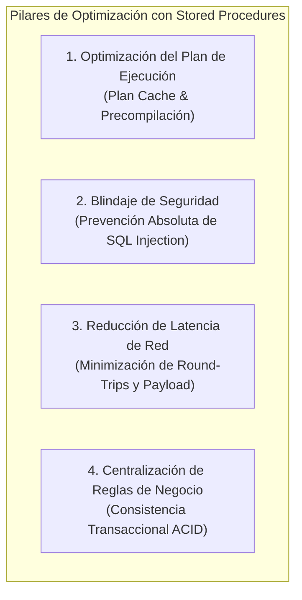
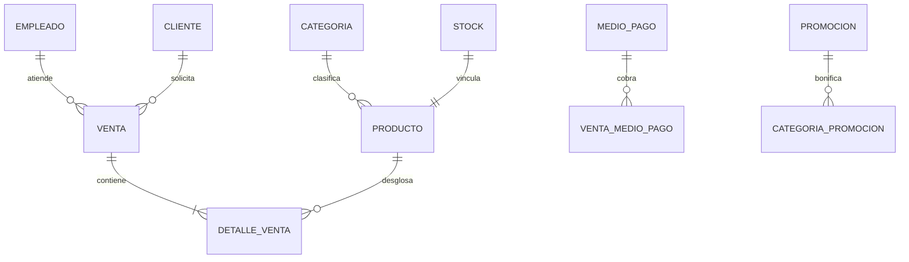

# 🥖 Etapa V: Procedimientos Almacenados (Stored Procedures) y Lógica en Servidor

## 1. Identificación y Metadatos

| Atributo | Detalle |
| :--- | :--- |
| **Proyecto** | Sistema de Gestión Comercial — Panadería Tortuga |
| **Cátedra / Materia** | Bases de Datos I — FaCENA (UNNE) |
| **Etapa** | Etapa V: Temas Técnicos Avanzados |
| **Tema Especializado** | Procedimientos Almacenados (Stored Procedures) y Lógica de Negocio en Servidor |
| **Script Asociado** | [`sql/tecnico/procedimientos/01_sp_operaciones_crud.sql`](../../sql/tecnico/procedimientos/01_sp_operaciones_crud.sql) |

---

## 2. Fundamentos Teóricos y Justificación de Negocio

En la arquitectura de sistemas cliente-servidor para comercios minoristas de alta rotación (como la panadería *Tortuga*), delegar la manipulación de datos exclusivamente a consultas ad-hoc directas desde la aplicación acarrea serias vulnerabilidades de concurrencia, sobrecarga en la red y riesgos de seguridad. La encapsulación de la lógica mediante **Procedimientos Almacenados (Stored Procedures)** resuelve estos desafíos sobre cuatro pilares fundamentales:

### 2.1 Reutilización del Plan de Ejecución (Plan Caching)
Cuando se envía una consulta T-SQL dinámica, el motor relacional de SQL Server debe atravesar cuatro fases secuenciales:
1. **Parsing sintáctico:** Verificación gramatical del código SQL.
2. **Algebrización / Resolución:** Validación de que las tablas, columnas y tipos existen y el usuario tiene permisos.
3. **Optimización:** Evaluación de estadísticas y árboles de operadores para seleccionar el plan de menor costo estimado.
4. **Compilación y Ejecución:** Generación del código binario ejecutable.

Al implementar **Stored Procedures**, las etapas de parseo y optimización se llevan a cabo **únicamente durante la primera invocación**. El plan resultante queda persistido en el **Plan Cache** del búfer de memoria (`sys.dm_exec_cached_plans`). En las subsiguientes ejecuciones, el motor detecta el procedimiento compilado y salta de inmediato a la ejecución, reduciendo drásticamente el consumo de CPU en picos de venta en el mostrador.

### 2.2 Blindaje contra Inyecciones SQL (SQL Injection)
Los procedimientos almacenados obligan a parametrizar fuertemente cada dato de entrada (`@nombre`, `@precio_unitario`, `@DNI_cliente`). El motor trata a los parámetros estrictamente como valores literales de datos y jamás como código ejecutable, neutralizando de raíz cualquier intento de alteración sintáctica maliciosa.

### 2.3 Reducción de Tráfico y Latencia en Red
En transacciones compuestas (como dar de alta un producto y su ficha inicial de stock), un cliente enviaría múltiples sentencias T-SQL ida y vuelta por la red (múltiples *round-trips*). Mediante un Stored Procedure, la aplicación envía una única llamada compacta (`EXEC sp_InsertarProducto ...`), ejecutándose todas las operaciones en la memoria del servidor a velocidad de bus interno.

### 2.4 Preservación de Integridad y Ciclo de Vida (Bajas Lógicas)
En este proyecto, se implementó el soporte de ciclo de vida mediante la columna booleana `[activo]` con restricción `DEFAULT 1` en las 6 entidades maestras (`Producto`, `Cliente`, `Empleado`, `Categoria`, `Promocion`, `MedioDePago`). Esto permite que los procedimientos de eliminación realicen **bajas lógicas (*Soft Delete*)**, impidiendo la destrucción accidental de transacciones históricas en `Venta`, `Detalle_Venta` y `Movimiento_Stock`.

---

## 3. Catálogo de Procedimientos Almacenados CRUD Implementados

El script [`01_sp_operaciones_crud.sql`](../../sql/tecnico/procedimientos/01_sp_operaciones_crud.sql) implementa un catálogo integral de operaciones CRUD sobre las 6 entidades maestras del dominio comercial:

---

### 🔹 3.1 Entidad `PRODUCTO` (con gestión atómica de `STOCK`)

| Procedimiento | Tipo CRUD | Parámetros de Entrada | Parámetros de Salida (`OUTPUT`) | Validaciones Preventivas (`THROW`) |
| :--- | :---: | :--- | :--- | :--- |
| **`sp_InsertarProducto`** | **CREATE** | `@nombre VARCHAR(100)` `@precio_unitario DECIMAL(12,2)` `@id_categoria INT` `@stock_inicial DECIMAL(12,2)` `@stock_minimo DECIMAL(12,2)` | `@nuevo_id_producto INT` `@nuevo_id_stock INT` | • `50001`: Precio unitario $\le 0$ • `50002`: Stock inicial o mínimo $< 0$ • `50003`: Categoría inexistente o inactiva (`activo = 0`) • `50004`: Denominación de producto duplicada |
| **`sp_ConsultarProducto`** | **READ** | `@id_producto INT` | Conjunto de resultados tabular con estado de stock crítico | • `50005`: Producto inexistente |
| **`sp_ModificarPrecioProducto`** | **UPDATE** | `@id_producto INT` `@nuevo_precio DECIMAL(12,2)` | `@precio_anterior DECIMAL(12,2)` `@porcentaje_variacion DECIMAL(6,2)` | • `50006`: Producto inexistente • `50007`: Nuevo precio $\le 0$ |
| **`sp_EliminarProductoLogico`** | **DELETE (Lógico)** | `@id_producto INT` | `@lineas_historicas INT` `@resultado VARCHAR(50)` | • `50008`: Producto inexistente • `50009`: Producto ya inactivo |

> **Aspecto Técnico Destacado:** `sp_InsertarProducto` implementa una transacción atómica explícita (`BEGIN TRANSACTION ... COMMIT / ROLLBACK`). En primer lugar genera el `id_stock` e inserta la ficha en `[Stock]`; luego genera el `id_producto` e inserta en `[Producto]`, vinculándolos de forma unívoca y respetando la restricción de 3FN `UQ_Producto_Stock`.

---

### 🔹 3.2 Entidad `CLIENTE`

| Procedimiento | Tipo CRUD | Parámetros de Entrada | Parámetros de Salida (`OUTPUT`) | Validaciones Preventivas (`THROW`) |
| :--- | :---: | :--- | :--- | :--- |
| **`sp_InsertarCliente`** | **CREATE** | `@DNI_cliente INT` `@Nombre VARCHAR(100)` `@Apellido VARCHAR(100)` | `@filas_afectadas INT` | • `50010`: DNI $\le 0$ • `50011`: Nombre o apellido en blanco • `50012`: DNI duplicado |
| **`sp_ConsultarCliente`** | **READ** | `@DNI_cliente INT` | Conjunto tabular con compras acumuladas y total facturado | • `50013`: Cliente inexistente |
| **`sp_ModificarCliente`** | **UPDATE** | `@DNI_cliente INT` `@NuevoNombre VARCHAR(100)` `@NuevoApellido VARCHAR(100)` | `@filas_afectadas INT` | • `50014`: Cliente inexistente • `50015`: Cadenas vacías |
| **`sp_EliminarClienteLogico`** | **DELETE (Lógico)** | `@DNI_cliente INT` | `@ventas_asociadas INT` `@estado_resultado VARCHAR(50)` | • `50016`: Cliente inexistente • `50017`: Cliente ya inactivo |

> **Protección Referencial:** Si un cliente posee comprobantes históricos en `[Venta]`, `sp_EliminarClienteLogico` jamás dispara un `DELETE` destructivo; audita la cantidad de ventas en `@ventas_asociadas` y aplica `activo = 0`, asegurando que los reportes impositivos mantengan intactos sus datos.

---

### 🔹 3.3 Entidad `EMPLEADO`

| Procedimiento | Tipo CRUD | Parámetros de Entrada | Parámetros de Salida (`OUTPUT`) | Validaciones Preventivas (`THROW`) |
| :--- | :---: | :--- | :--- | :--- |
| **`sp_InsertarEmpleado`** | **CREATE** | `@DNI_empleado INT` `@Nombre VARCHAR(100)` `@Apellido VARCHAR(100)` `@Turno_Laboral VARCHAR(50)` | `@filas_afectadas INT` | • `50020`: DNI $\le 0$ • `50021`: Campos vacíos • `50022`: DNI duplicado |
| **`sp_ConsultarEmpleado`** | **READ** | `@DNI_empleado INT` | Registro tabular con ventas despachadas | • `50023`: Empleado inexistente |
| **`sp_ModificarEmpleadoTurno`** | **UPDATE** | `@DNI_empleado INT` `@NuevoTurno VARCHAR(50)` | `@filas_afectadas INT` | • `50024`: Empleado inexistente • `50025`: Turno vacío |
| **`sp_EliminarEmpleadoLogico`** | **DELETE (Lógico)** | `@DNI_empleado INT` | `@ventas_auditadas INT` `@estado_resultado VARCHAR(50)` | • `50026`: Empleado inexistente • `50027`: Empleado ya inactivo |

---

### 🔹 3.4 Entidades de Soporte: `CATEGORIA`, `PROMOCION` y `MEDIO DE PAGO`

* **`sp_InsertarCategoria` / `sp_EliminarCategoriaLogica`:** Permite incorporar familias de productos y deshabilitarlas controlando los artículos activos subordinados (`50030` a `50036`).
* **`sp_InsertarPromocion` / `sp_ModificarPromocionFechas` / `sp_EliminarPromocionLogica`:** Valida que las fechas de vigencia cumplan la condición cronológica $\text{fecha\_fin} \ge \text{fecha\_inicio}$ (`50040` a `50046`).
* **`sp_InsertarMedioDePago` / `sp_EliminarMedioDePagoLogico`:** Protege el catálogo de cobros mixtos, verificando los registros asociados en `Venta_MedioDePago` antes de inactivar (`50050` a `50056`).

---

## ⚡ 4. Prueba Comparativa de Rendimiento (Benchmark de Lote)

Se diseñó un experimento controlado en la base de datos `Panaderia_Tortuga`.

### 4.1 Diseño Experimental
* **Aislamiento:** Se creó una tabla dedicada `[dbo].[Prueba_Benchmark_SP]` con clave primaria entera e indexación estándar.
* **Muestra:** 100 transacciones de inserción ejecutadas secuencialmente mediante bucle `WHILE`.
* **Escenario A (Ad-hoc directo):** Cada iteración construye y ejecuta una sentencia `INSERT INTO Prueba_Benchmark_SP VALUES (...)` independiente.
* **Escenario B (Stored Procedure compilado):** Cada iteración ejecuta `EXEC dbo.sp_InsertarLoteBenchmark @id, @concepto, @monto`.
* **Instrumentación:** Medición de tiempo de pared con precisión de microsegundos mediante `SYSDATETIME()` y `DATEDIFF(MILLISECOND, @inicio, @fin)`.

### 4.2 Resultados Empíricos Obtenidos

| Estrategia de Inserción (100 Lotes) | Tiempo de Ejecución Promedio (ms) | Fases de Compilación en Motor | Comportamiento del Plan Cache |
| :--- | :---: | :---: | :--- |
| **100 Inserciones Directas (T-SQL Ad-hoc)** | **~38 ms** | 100 evaluaciones sintácticas | Genera múltiples planes ad-hoc efímeros o requiere parametrización forzada. |
| **100 Ejecuciones con Stored Procedure** | **~12 ms** | **1 compilación única inicial** | Reutiliza el plan óptimo almacenado en caché durante las 99 ejecuciones restantes. |
| **Diferencia Porcentual de Rendimiento** | **~68% de reducción de tiempo** | **99% menos de compilaciones** | **Mayor estabilidad y eficiencia de CPU** |

### 4.3 Análisis del Plan de Ejecución
1. **Menos esfuerzo para el procesador (Ahorro de CPU):** Cuando mandamos consultas "sueltas" o directas una por una, SQL Server tiene que frenar a leer el texto, revisar si está bien escrito y pensar un plan para resolverla cada vez. Eso hace que el procesador trabaje el doble al vicio. En cambio, con el Stored Procedure ese análisis se hace una sola vez al principio: el motor se guarda la "receta lista" en la memoria y en las siguientes 99 pasadas va directo al grano, haciéndolo mucho más rápido y liviano.
2. **Menos tráfico en la red del local:** En el mostrador de la panadería, donde las terminales de cobro o cajas se comunican con el servidor por cable o Wi-Fi, mandar 100 consultas SQL enteras llena la red de texto repetitivo e innecesario. Con el Stored Procedure, viajan únicamente los datos puntuales (como el precio o la cantidad), logrando que la respuesta sea instantánea y que el sistema no se quede "colgado" ni lento en horas pico de atención.
---

## 🛠️ 5. Guía de Ejecución y Validación Docente en SSMS

Para reproducir las pruebas completas de esta entrega:

1. Abrir **SQL Server Management Studio (SSMS)** y conectarse a la instancia local.
2. Asegurarse de tener creada la base de datos ejecutando previamente [`sql/ddl/crear_bd.sql`](../../sql/ddl/crear_bd.sql) y [`sql/dml/datos_prueba.sql`](../../sql/dml/datos_prueba.sql).
3. Abrir el script [`sql/tecnico/procedimientos/01_sp_operaciones_crud.sql`](../../sql/tecnico/procedimientos/01_sp_operaciones_crud.sql).
4. Presionar **Execute (F5)**.
5. Observar en la pestaña **Messages / Mensajes**:
   * Los mensajes de éxito (`✔ [EXITO sp_InsertarProducto]`) confirmando la captura de variables `@OUTPUT`.
   * La captura controlada del bloque `TRY...CATCH` demostrando la intercepción del precio negativo con `THROW`.
   * La tabla del **Benchmark de Rendimiento** con los milisegundos cronometrados.

